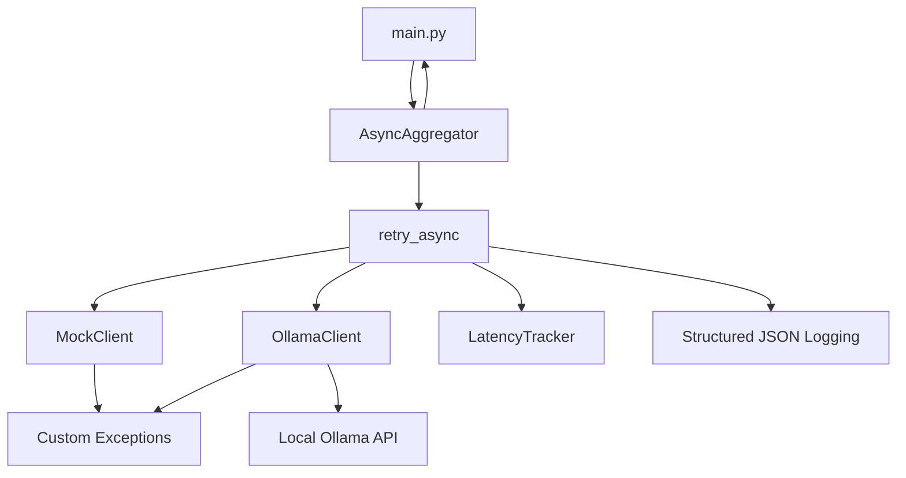

# Async LLM Provider Aggregator

Week 3 of my **Applied AI / LLM Engineering** learning roadmap.

This project focuses on asynchronous Python, concurrent provider execution, failure isolation, retries, timeouts, structured logging, and local LLM integration using Ollama.

The goal was to build a small but realistic LLM provider gateway that can call multiple providers concurrently without allowing one slow or failed provider to break the entire request.

---

## Project Goals

This project was built to practice and demonstrate:

* Python `async` / `await`
* Coroutine execution
* `asyncio.gather()`
* Concurrent provider calls
* Per-provider timeouts
* Partial failure handling
* Async HTTP using `httpx.AsyncClient`
* Local LLM integration with Ollama
* Async retry logic
* Exponential backoff
* Jitter
* Transient vs permanent error classification
* Structured logging
* Latency measurement
* Automated testing with `pytest`

---

## Architecture



The main execution flow is:

```text
main.py
    ↓
AsyncAggregator
    ↓
asyncio.wait_for()
    ↓
retry_async()
    ↓
client.generate()
    ↓
MockClient / OllamaClient
```

Each provider runs independently.

A failure from one provider does not prevent successful responses from other providers from being returned.

---

## Project Structure

```text
03-async-llm-aggregator/
│
├── main.py
├── README.md
├── requirements.txt
│
├── experiments/
│   └── concurrent_tasks.py
│
├── src/
│   ├── __init__.py
│   ├── aggregator.py
│   ├── config.py
│   ├── models.py
│   │
│   ├── clients/
│   │   ├── __init__.py
│   │   ├── mock_client.py
│   │   └── ollama_client.py
│   │
│   ├── observability/
│   │   ├── __init__.py
│   │   ├── logHelper.py
│   │   ├── metrics.py
│   │   └── writer.py
│   │
│   └── utils/
│       ├── __init__.py
│       ├── exceptions.py
│       └── retry.py
│
└── tests/
    ├── __init__.py
    ├── test_aggregator.py
    └── test_retry.py
```

---

## Main Components

### `main.py`

Acts as the application entry point.

Responsibilities:

* Creates provider clients
* Configures the aggregator
* Defines timeout and retry settings
* Sends the prompt
* Measures overall aggregation time
* Writes output and latency information

Example configuration:

```python
aggregator = AsyncAggregator(
    clients=clients,
    timeout=10,
    max_attempts=3,
    base_delay=0.5,
    jitter=0.25,
)
```

---

## `AsyncAggregator`

Located in:

```text
src/aggregator.py
```

The aggregator runs all configured providers concurrently.

Each provider operation is wrapped with:

```text
asyncio.wait_for
        ↓
retry_async
        ↓
client.generate
```

Conceptually:

```python
asyncio.wait_for(
    retry_async(
        client.generate,
        prompt,
    ),
    timeout=timeout,
)
```

This means the timeout applies to the complete provider operation, including retry attempts and backoff.

The results are collected using:

```python
asyncio.gather(
    *tasks,
    return_exceptions=True,
)
```

Using `return_exceptions=True` allows one provider to fail while successful provider responses are still preserved.

---

## Provider Response Model

All providers return the same response structure.

```python
@dataclass(slots=True)
class ProviderResponse:
    provider: str
    text: str | None
    latency_seconds: float | None
    success: bool
    error: str | None = None
```

Example successful response:

```text
ProviderResponse(
    provider="Ollama client",
    text="Generated response...",
    latency_seconds=5.24,
    success=True,
    error=None
)
```

Example failed response:

```text
ProviderResponse(
    provider="Ollama client",
    text=None,
    latency_seconds=None,
    success=False,
    error="Ollama client connection failed"
)
```

---

## Mock Provider

`MockClient` allows provider behavior to be tested without using a real LLM.

It supports:

* Artificial latency
* Normal success
* Permanent failure
* Temporary failures followed by recovery

Example:

```python
retry_client = MockClient(
    name="Retry Client",
    delay=1.2,
    failures_before_success=2,
)
```

This produces:

```text
Attempt 1 → temporary failure
Attempt 2 → temporary failure
Attempt 3 → success
```

A permanent failure can be simulated using:

```python
MockClient(
    name="Permanent Failure Client",
    should_fail=True,
)
```

Permanent failures are intentionally not retried.

---

## Ollama Provider

`OllamaClient` communicates asynchronously with a locally running Ollama server.

Endpoint:

```text
POST /api/generate
```

Example request payload:

```json
{
  "model": "gemma3:4b",
  "prompt": "Should I continue learning Applied AI?",
  "stream": false
}
```

`stream: false` is used so that Ollama returns a single JSON response instead of newline-delimited streaming chunks.

---

## Error Classification

The project uses a custom exception hierarchy.

```text
AggregatorError
│
├── TransientProviderError
│   │
│   ├── ClientTimeoutError
│   ├── ProviderConnectionError
│   ├── RateLimitExceededError
│   └── ProviderServerError
│
└── ModelNotFoundError
```

The distinction is important because not every error should be retried.

### Retryable errors

Examples:

```text
Temporary connection failure
Request timeout
HTTP 429
HTTP 5xx
```

These inherit from:

```python
TransientProviderError
```

and may be retried.

### Non-retryable errors

Example:

```text
Model not found
Programming errors
Permanent mock provider failure
```

These are not automatically retried.

---

## Async Retry

Retry logic is implemented in:

```text
src/utils/retry.py
```

The retry utility accepts an async callable:

```python
retry_async(
    client.generate,
    prompt,
)
```

Inside the retry function:

```text
attempt provider operation
        ↓
success?
  ├── yes → return
  │
  └── no
       ↓
TransientProviderError?
       ↓
last attempt?
  ├── yes → raise
  │
  └── no
       ↓
calculate backoff
       ↓
await asyncio.sleep()
       ↓
retry
```

The important async rule is:

```python
await asyncio.sleep(delay)
```

instead of:

```python
time.sleep(delay)
```

`asyncio.sleep()` does not block the event loop while waiting.

---

## Exponential Backoff

Retry delay is calculated using:

```python
delay = base_delay * (2 ** (attempt - 1))
```

For example:

```text
base_delay = 1 second

Attempt 1 fails → wait 1 second
Attempt 2 fails → wait 2 seconds
Attempt 3 fails → stop
```

---

## Jitter

Optional random jitter can be added to retry delays.

Example:

```text
Calculated backoff = 1.0 sec
Jitter             = 0.16 sec

Actual delay       = 1.16 sec
```

Jitter helps prevent many clients from retrying a failed service simultaneously.

---

## Timeout Behavior

The aggregator wraps the entire retry sequence with:

```python
asyncio.wait_for(...)
```

For example:

```text
Provider timeout = 10 seconds

attempt 1
    ↓
failure
    ↓
backoff
    ↓
attempt 2
    ↓
failure
    ↓
backoff
    ↓
attempt 3
```

If the complete process exceeds 10 seconds:

```text
asyncio.wait_for
        ↓
TimeoutError
        ↓
failed ProviderResponse
```

This prevents a provider from blocking the gateway indefinitely.

---

## Partial Failure Handling

One of the main goals of this project is failure isolation.

Example:

```text
Provider A → SUCCESS
Provider B → TIMEOUT
Provider C → SUCCESS
Ollama     → CONNECTION FAILURE
```

The aggregator still returns results from Providers A and C.

The entire request does not fail because one provider failed.

---

## Structured Logging

The project uses JSON structured logging.

Logs include information such as:

```text
timestamp
level
message
service
environment
provider
attempt
status
retry delay
error
```

Example:

```json
{
  "level": "WARNING",
  "event": "provider_retry",
  "provider": "Ollama client",
  "attempt": 2,
  "max_attempts": 3,
  "status": "retrying",
  "retry_delay_seconds": 1.16
}
```

Logs are written to:

```text
logs/app.log
```

Log rotation is handled using:

```python
TimedRotatingFileHandler
```

---

## Latency Metrics

The project includes a reusable `LatencyTracker`.

Supported metrics include:

```text
total calls
average latency
p95 latency
maximum latency
minimum latency
```

Latency measurements can be used to understand individual provider-attempt performance while `main.py` separately measures total aggregation execution time.

This distinction is important:

```text
Provider attempt latency
        ≠
total provider retry duration
        ≠
whole aggregation duration
```

---

## Concurrency

Without concurrency:

```text
Provider A → 2 sec
Provider B → 3 sec
Provider C → 1 sec

Total ≈ 6 sec
```

With asynchronous concurrent execution:

```text
Provider A  ██████████
Provider B  ███████████████
Provider C  █████

Total ≈ 3 sec
```

The total time is approximately the duration of the slowest concurrent operation instead of the sum of all provider durations.

---

## Automated Tests

The project uses:

```text
pytest
pytest-asyncio
```

Tests cover:

* successful result preservation
* partial provider failure
* provider timeout
* bounded gateway execution
* provider-specific failure information
* asyncio timeout behavior
* transient retry recovery
* retry exhaustion
* permanent errors not being retried
* aggregator result isolation
* concurrent provider execution

Run tests with:

```bash
pytest -v
```

---

## Installation

Create and activate a virtual environment.

Example:

```bash
python -m venv .venv
```

Windows:

```bash
.venv\Scripts\activate
```

Install dependencies:

```bash
pip install -r requirements.txt
```

---

## Requirements

```text
httpx
python-dotenv
pytest
pytest-asyncio
```

---

## Ollama Setup

This project uses a local Ollama instance.

Example model:

```text
gemma3:4b
```

Start Ollama and make sure the model is available.

Example:

```bash
ollama pull gemma3:4b
```

Environment variables can be configured in `.env`:

```text
OLLAMA_BASE_URL=http://localhost:11434
OLLAMA_MODEL=gemma3:4b
REQUEST_TIMEOUT_SECONDS=60
```

The `.env` file is excluded from Git through `.gitignore`.

---

## Running the Project

From the Week 3 project directory:

```bash
python main.py
```

Example provider setup:

```text
Retry Client
Permanent Failure Client
Normal Client
Ollama client
```

Possible output:

```text
Aggregation Results
============================================================

Provider : Retry Client
Status   : SUCCESS

Provider : Permanent Failure Client
Status   : FAILED

Provider : Normal Client
Status   : SUCCESS

Provider : Ollama client
Status   : SUCCESS / FAILED depending on local availability

============================================================
Aggregation completed.
```

---

## Key Lessons

This project helped me understand that asynchronous programming is not simply adding `async` and `await`.

I learned how different layers of a real application interact:

```text
request
   ↓
aggregator
   ↓
retry policy
   ↓
provider client
   ↓
external service
   ↓
response/error
```

I also learned:

* how functions and bound methods can be passed as callables
* how coroutines differ from normal function calls
* why blocking functions such as `time.sleep()` should not be used inside async retry logic
* how `asyncio.gather()` enables concurrent execution
* how `asyncio.wait_for()` provides a bounded execution time
* why transient and permanent errors should be handled differently
* how retries, exponential backoff, and jitter work
* how one provider failure can be isolated from other providers
* how structured logging helps explain what happened internally
* why latency metrics need clearly defined meaning
* how automated tests can verify system behavior instead of only checking that code runs

---

## Week 3 Outcome

The final project demonstrates a small resilient asynchronous LLM gateway capable of:

```text
Concurrent provider execution
        +
Timeout protection
        +
Partial failure handling
        +
Transient retry
        +
Exponential backoff
        +
Jitter
        +
Structured logging
        +
Latency metrics
        +
Local Ollama integration
        +
Automated testing
```

This project provides the async and reliability foundation needed for the next stage of the roadmap: building API-based Applied AI services.
