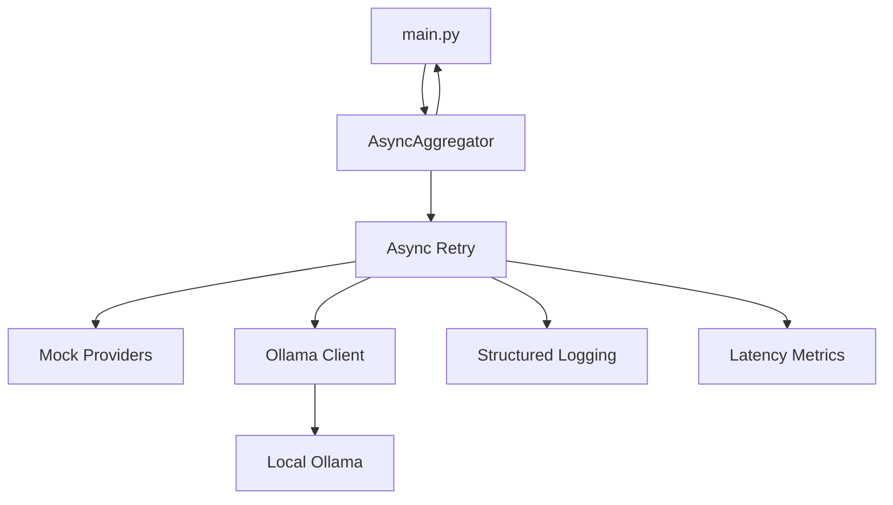

# Applied AI / LLM Engineering

A project-first learning repository documenting my transition from software engineering into **Applied AI / LLM Engineering**.

The goal of this repository is not only to learn AI frameworks, but to build the Python, backend, reliability, observability, asynchronous programming, and system-design skills required to build production-oriented AI applications.

Each week focuses on one engineering concept and applies it through a practical project.

---

## Engineering Principles

This repository follows several core principles:

* Learn by building
* Understand the system instead of memorizing code
* Clean architecture over notebook-only development
* Observability from the beginning
* Failure-aware engineering
* Automated testing
* Measure performance instead of guessing
* Reuse engineering concepts across projects
* Increase implementation independence over time

---

# Learning Roadmap

## Phase 1 — Python & Backend Engineering Foundations

```text
Observability
      ↓
Retry & Reliability
      ↓
Async Programming
      ↓
FastAPI Services
```

Topics include:

* decorators
* structured logging
* latency measurement
* retry and backoff
* exception design
* asyncio
* asynchronous HTTP
* concurrent provider execution
* API development

---

## Phase 2 — Applied ML & NLP

Planned topics:

* embeddings
* semantic search
* vector databases
* retrieval pipelines

---

## Phase 3 — Applied AI Systems

Planned topics:

* Retrieval-Augmented Generation
* tool calling
* AI agents
* memory systems
* multi-agent workflows

---

## Phase 4 — Production Engineering

Planned topics:

* deployment
* monitoring
* evaluation
* system design
* performance optimization

---

# Weekly Projects

| Week | Project                  | Core Topics                                          | Status      |
| ---- | ------------------------ | ---------------------------------------------------- | ----------- |
| 1    | Observability Decorators | decorators, logging, metrics, latency                | ✅ Completed |
| 2    | Retry & Backoff          | retry policy, jitter, structured failures            | ✅ Completed |
| 3    | Async LLM Aggregator     | asyncio, concurrency, Ollama, timeout, async retry   | ✅ Completed |
| 4    | FastAPI AI Service       | API design, request/response models, async endpoints | ⏳ Planned   |

---

# Week 1 — Observability Decorators

Directory:

```text
01-observability-decorators/
```

### Main Topics

* Python decorators
* execution-time measurement
* structured JSON logging
* latency tracking
* thread-safe metrics
* p95 latency
* reusable observability utilities

### Project Outcome

Built reusable instrumentation that can:

```text
function execution
        ↓
clock decorator
        ↓
latency measurement
        ↓
structured logging
        ↓
metrics summary
```

---

# Week 2 — Retry & Backoff

Directory:

```text
02-retry-backoff/
```

### Main Topics

* retry patterns
* exponential backoff
* jitter
* transient failures
* structured retry logging
* pytest testing

### Project Outcome

Built a retry mechanism capable of recovering from simulated temporary failures while limiting retry attempts and recording retry behavior.

Conceptual flow:

```text
operation
   ↓
failure
   ↓
retryable?
   ├── no → raise
   │
   └── yes
        ↓
     backoff
        ↓
      retry
```

---

# Week 3 — Async LLM Provider Aggregator

Directory:

```text
03-async-llm-aggregator/
```

### Main Topics

* `async` / `await`
* coroutines
* event loop behavior
* `asyncio.gather()`
* asynchronous concurrency
* `asyncio.wait_for()`
* partial failure handling
* async retry
* exponential backoff
* jitter
* asynchronous HTTP
* local Ollama integration
* custom exception hierarchy
* structured logging
* latency metrics
* pytest async testing

### Architecture



### Project Outcome

Built an asynchronous provider gateway that can:

* execute multiple providers concurrently
* retain successful results when another provider fails
* enforce provider execution timeouts
* retry only transient failures
* use non-blocking async backoff
* apply exponential backoff and jitter
* integrate with a local Ollama model
* normalize responses into a common model
* record structured operational logs
* test async failure scenarios automatically

---

# Current Repository Structure

```text
Applied-AI-LLM-Engineering/
│
├── 01-observability-decorators/
│
├── 02-retry-backoff/
│
├── 03-async-llm-aggregator/
│
├── .gitignore
├── LICENSE
└── README.md
```

Each project directory contains the implementation and supporting material for that week's engineering topic.

---

# Current Tech Stack

### Language

```text
Python
```

### Backend / Networking

```text
asyncio
httpx
FastAPI — upcoming
```

### AI / LLM

```text
Ollama
gemma3:4b
```

### Testing

```text
pytest
pytest-asyncio
```

### Observability

```text
Python logging
JSON structured logs
TimedRotatingFileHandler
custom latency metrics
```

### Configuration

```text
python-dotenv
environment variables
```

---

# Learning Approach

The projects are intentionally incremental.

Concepts introduced in earlier weeks are reused in later projects.

For example:

```text
Week 1
Observability
     │
     ▼
Week 2
Retry + Observability
     │
     ▼
Week 3
Async + Retry + Observability + LLM Provider
     │
     ▼
Week 4
API Service
```

This allows each project to add one new engineering layer instead of starting from zero.

---

# Development Philosophy

The goal is to progress from:

```text
Understand code after explanation
```

toward:

```text
Requirement
    ↓
Design
    ↓
Implementation
    ↓
Testing
    ↓
Debugging
    ↓
Documentation
```

Each project is used not only to learn syntax but to practice how multiple components interact inside a real application.

---

# Upcoming Work

The next stage focuses on exposing AI functionality through backend services.

Planned progression:

```text
FastAPI
   ↓
Embeddings
   ↓
Semantic Search
   ↓
Vector Databases
   ↓
RAG
   ↓
Tool Calling
   ↓
Agents
   ↓
Deployment & Monitoring
```

---

# Author

**Abdullah Jonaed**

Software Engineer → Applied AI / LLM Engineer
